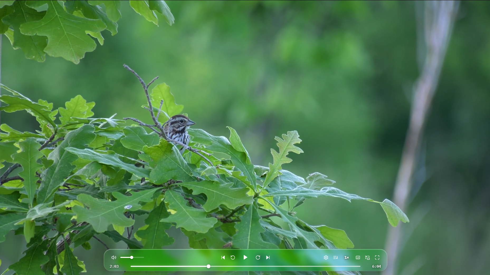
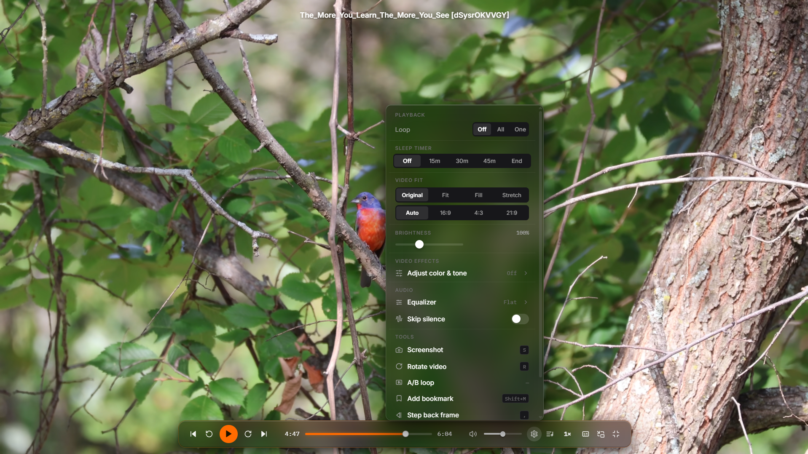
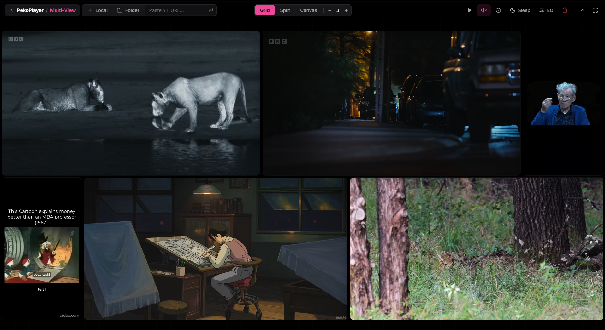
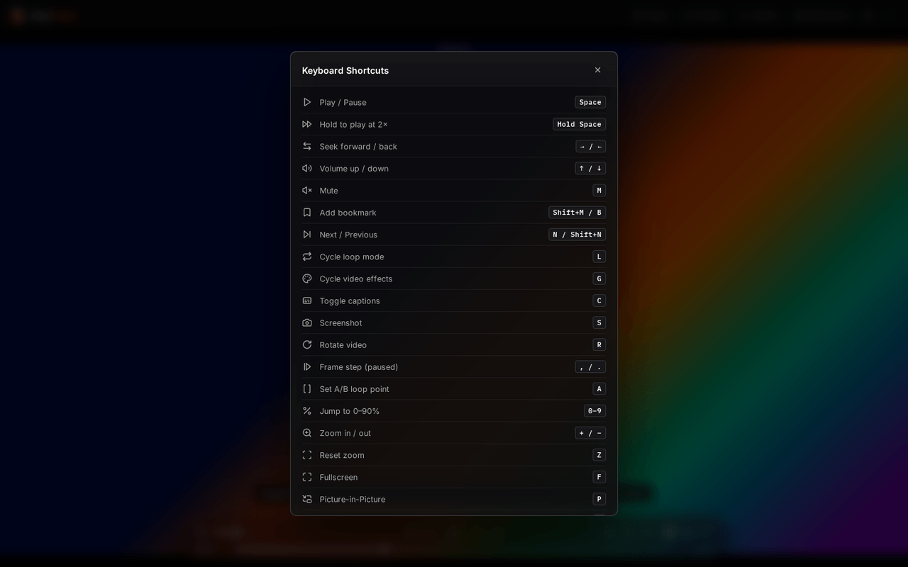

<p align="center"></p>

<h1 align="center">PekoPlayer</h1>

<p align="center">
  <strong>A private video player for your browser and desktop.</strong><br>
  Play local files, search subtitles like a document, shape the picture with WebGL2 effects, and watch several videos at once.<br>
  No account, no uploads, no telemetry.
</p>

<p align="center">
  <a href="https://rishipx.github.io/PekoPlayer/"><strong>Open the web app</strong></a> ·
  <a href="https://github.com/rishipx/PekoPlayer/releases/latest"><strong>Download for Windows</strong></a> ·
  <a href="#documentation">Documentation</a>
</p>

<p align="center">
  <a href="https://github.com/rishipx/PekoPlayer/actions/workflows/ci.yml"></a>
</p>

<p align="center"></p>

## Why PekoPlayer

- **Private by design.** Videos never leave your device. There is no backend, no analytics and no error reporting, and a test fails the build if a request to a third party sneaks in. See [Privacy](#privacy).
- **Works offline.** The website installs as an app and keeps working without a connection, and the Windows app needs none at all.
- **More than a play button.** Transcript search, chapters, bookmarks, A-B loops, an equalizer, video effects and a multi-view wall, all from the keyboard.

## Features

**Playback**
- Local files, whole folders and drag and drop: MP4, WebM, OGG, MOV, MKV and 3GP, as far as the browser can decode them
- Speed control, frame stepping, A-B loop, silence skipping and a sleep timer
- Picture-in-Picture, fullscreen, media keys and casting where the browser supports them
- Resume where you left off, and bookmarks you can click to jump to

**Subtitles and search**
- `.srt` and `.vtt` subtitles with adjustable delay and style
- Transcript search on your device: type a word, see every line that says it, click to seek. Small typos still match
- Chapters from yt-dlp `.info.json` files, or detected from pauses in the dialogue

**Picture and sound**
- WebGL2 effects with presets (Vivid, Cinematic, Warm, Cool, Film, Mono, Sharp) and sliders for exposure, contrast, saturation, temperature, tint, sharpness and vignette
- Equalizer with presets, rotation, zoom and pan, and screenshots that include the effects

**Playlists**
- Shuffle, sort, loop modes, a carousel view and thumbnail previews on hover

**Multi-view**
- Local videos and YouTube links side by side in a free canvas, a smart grid or a split layout
- Reorder tiles by dragging, and resize panes with handles, without anything overlapping or being cropped
- Play, mute and restart controls for the whole wall, and per-tile controls for each video

**Everywhere**
- Installable as an app, fully offline, and built to be driven from the keyboard (press `?` for every shortcut)
- A portable Windows app that adds itself to the **Open with** menu

## Screenshots

<table>
  <tr>
    <td width="50%"><br><sub><b>Transcript search.</b> Find a line, click to jump to it.</sub></td>
    <td width="50%"><br><sub><b>Video effects.</b> Presets and fine control.</sub></td>
  </tr>
  <tr>
    <td width="50%"><br><sub><b>Multi-view, grid.</b> Every video keeps its shape.</sub></td>
    <td width="50%"><br><sub><b>Multi-view, split.</b> Drag the handle between panes to resize.</sub></td>
  </tr>
</table>

More: [keyboard shortcuts](docs/images/keyboard-shortcuts.png) and the [empty state](docs/images/player-empty-state.png).

## Get it

| | |
|---|---|
| **Web app** | Open the site, then use the browser's install button (or **Install web app** in the shortcuts panel, `?`). After the first visit it works offline. |
| **Windows** | Download `PekoPlayer-<version>-portable.exe` from the [latest release](https://github.com/OWNER/PekoPlayer/releases/latest) and run it. There is no installer and no administrator rights are needed. Windows may warn about an unsigned app: choose **More info**, then **Run anyway**, and compare the file with the published `.sha256`. |
| **From source** | See [Quick start](#quick-start). |

## Quick start

Requires [Node.js](https://nodejs.org) 22 (see `.nvmrc`).

```bash
npm ci
npm run build
npm run serve     # open http://localhost:8080
```

Open the served URL rather than `dist/index.html`: the offline mode and install prompt need `http://localhost` or HTTPS.

To try the desktop app or build the Windows executable:

```bash
npm run desktop:start   # run it
npm run desktop:dist    # build release/PekoPlayer-<version>-portable.exe
```

## Keyboard

| Key | Action | Key | Action |
|---|---|---|---|
| `Space` | Play or pause | `/` | Search the transcript and chapters |
| `←` `→` | Seek | `V` | Multi-view |
| `↑` `↓` | Volume | `G` | Cycle video effects |
| `B` | Add a bookmark | `A` | Set an A-B loop point |
| `P` | Picture-in-Picture | `S` | Screenshot |
| `F` | Fullscreen | `?` | Every shortcut |

In multi-view, `[` and `]` move the active tile earlier or later.

## Using it

| Action | How |
|---|---|
| Add media | **Open** or **Folder** in the top bar, or drag and drop. Subtitle and `.info.json` files are matched by name. |
| Hide the top bar | The small up arrow next to the `?` icon. Move the pointer to the top edge to reveal a down arrow, and click it to bring the bar back. On touch screens the arrow is always visible. The choice is remembered. |
| Bookmarks | `B` or `Shift+M` adds one. Click a marker to jump to it, right-click to remove it. |
| Arrange multi-view | Drag a tile's header to reorder it. Drag the handles between panes to resize them. Double-click a handle to reset. See [Multi-view](docs/multi-view.md). |
| Open from the file manager | The installed web app and the Windows app both appear in **Open with** for video files. |

## Privacy

- No analytics, telemetry, error reporting, cookies or accounts. `npm run check` fails if a network API built for telemetry or an unapproved host appears in the sources, and a smoke test verifies that startup makes no third-party request.
- Fonts, icons and all code are served from the same origin. Nothing loads from a CDN.
- Videos, subtitles and transcripts are processed on your device. Resume positions, bookmarks, thumbnails and settings are kept in your browser's `localStorage` and IndexedDB and never leave it.
- Two features contact third parties, and only when you use them: a YouTube tile in multi-view loads the YouTube player (from `youtube-nocookie.com`), and the subtitle search link opens opensubtitles.org in a new tab with the video's file name in the address.
- The address bar is never modified: file names and playback positions do not end up in the URL or in browser history.

## Browser support

Developed and tested in Chromium. The player uses WebGL2 in a worker (`OffscreenCanvas`), `requestVideoFrameCallback` and Picture-in-Picture APIs; browsers without them fall back or hide the feature. Firefox and WebKit get a startup check in CI. Which video formats play depends on the browser's codecs.

## Development

| Command | What it does |
|---|---|
| `npm run build` | Build to `dist/` |
| `npm run build:pages` | Build with the Content-Security-Policy embedded as a `<meta>` tag (for GitHub Pages) |
| `npm run serve` | Serve `dist/` on port 8080 with the production headers |
| `npm run lint` / `npm run format` | ESLint and Prettier |
| `npm run check` | Static checks (syntax, CSS, naming, leftover markers, privacy guard) |
| `npm run test:unit` | Fast Node tests for the pure logic |
| `npm test` | Lint, format check, checks, unit tests, build and smoke tests |
| `npm run desktop:dist` | Build the portable Windows executable into `release/` |
| `npm run fonts:vendor` · `icons:lucide` · `icons` | Refresh the bundled fonts, vendored icons and app icons |
| `npm run docs:screenshots` | Regenerate the screenshots in `docs/images` from the real app |

```
src/        Application source: HTML, CSS, browser scripts, workers, icons
src/shared/ Code and constants used by more than one bundle or worker
public/     Files copied to the build unchanged (manifest, app icons, fonts)
desktop/    Electron shell for the portable Windows executable
branding/   App icon master and the social preview image
tools/      Node tooling: build, check, font and icon helpers, dev server
tests/      Unit tests, smoke tests and fixtures
docs/       Guides and screenshots
.github/    CI, Pages deployment, releases, issue and pull request templates
```

## Documentation

- [Architecture](docs/architecture.md): source layout, how the large classes are split, the build, the CSP and the service worker
- [Multi-view](docs/multi-view.md): layouts, reordering and resizing
- [Desktop build](docs/desktop.md): the portable Windows executable
- [Deployment](docs/deployment.md): GitHub Pages, Cloudflare, Netlify and other hosts
- [Publishing](docs/publishing.md): putting the project on GitHub and cutting a release
- [Testing](docs/testing.md): the test suites and fixtures
- [Debug tools](docs/debugging.md): the hidden diagnostics panel (Ctrl+Shift+D)
- [Contributing](CONTRIBUTING.md) · [Security policy](SECURITY.md) · [Disclaimer](DISCLAIMER.md)

## License

[MIT](LICENSE). Lucide icons are ISC licensed ([src/icons/LICENSE](src/icons/LICENSE)) and the bundled fonts use the SIL Open Font License ([public/fonts/LICENSE.txt](public/fonts/LICENSE.txt)). See the [Disclaimer](DISCLAIMER.md).
