<p align="center">
  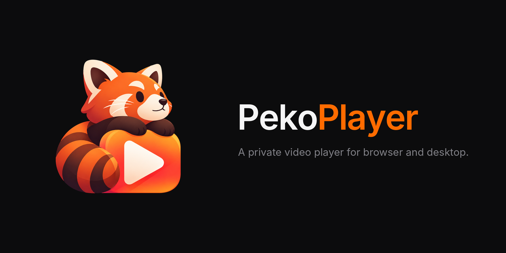
</p>

<p align="center">
  <a href="https://OWNER.github.io/PekoPlayer/">Web app</a> ·
  <a href="https://github.com/OWNER/PekoPlayer/releases/latest">Windows download</a> ·
  <a href="#documentation">Docs</a> ·
  <a href="https://github.com/OWNER/PekoPlayer/actions/workflows/ci.yml"></a>
</p>

PekoPlayer plays video files from your own device, in the browser or as a portable Windows app. It has no backend: nothing is uploaded, and there are no accounts, analytics or error reports.

<p align="center">
  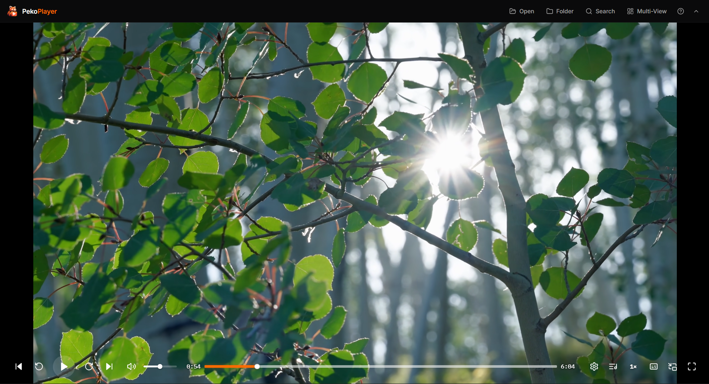
</p>

---

### Features

- **Playback.** Files, folders and drag and drop (MP4, WebM, OGG, MOV, MKV, 3GP, as far as your browser can decode them). Speed control, frame stepping, A-B loop, silence skipping, sleep timer, Picture-in-Picture, resume position, bookmarks.
- **Transcript search.** `.srt` and `.vtt` subtitles become a searchable transcript. Every match links to that moment, and small typos still match. Chapters from yt-dlp `.info.json` files or detected from pauses in the dialogue.
- **Picture.** WebGL2 effects with presets and sliders for exposure, contrast, saturation, temperature, tint, sharpness and vignette. Brightness, fit and aspect ratio, rotate, zoom, screenshots that include the effects.
- **Sound.** Equalizer with presets, skip silence, volume and speed control.
- **Playlists.** Sidebar or carousel, shuffle, sorting, loop modes, thumbnail previews.
- **Multi-view.** Local files and YouTube links side by side in a grid, split or free canvas layout.
- **Interface.** Three control bar layouts, three looks, eight accent colors plus a custom one, elapsed or remaining time.

---

### Screenshots

<table>
  <tr>
    <td width="50%">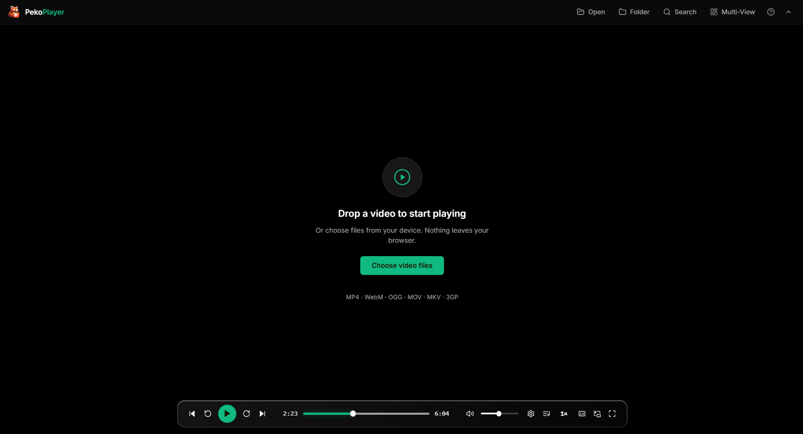<br><sub><b>Empty state</b></sub></td>
    <td width="50%">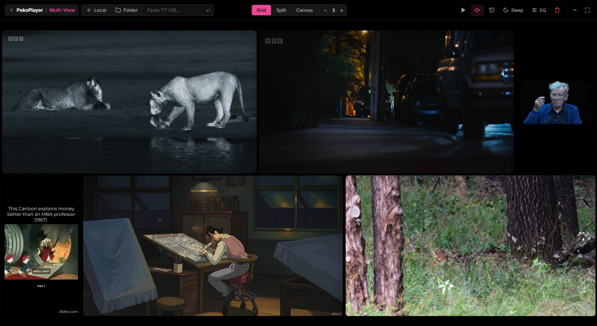<br><sub><b>Multi-view</b></sub></td>
  </tr>
  <tr>
    <td width="50%">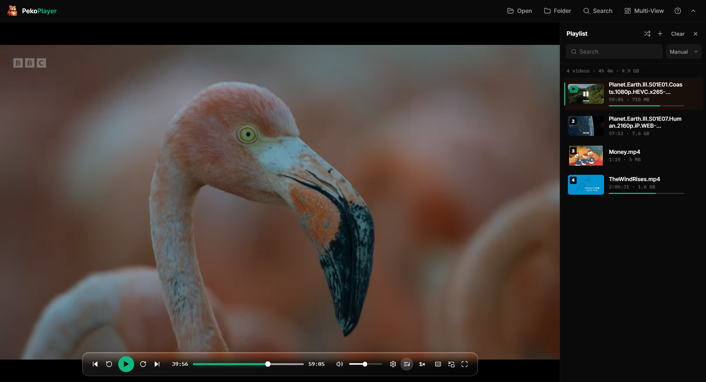<br><sub><b>Playlist sidebar</b></sub></td>
    <td width="50%">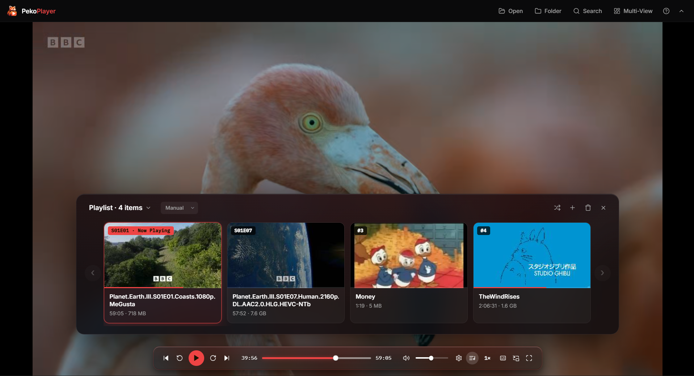<br><sub><b>Playlist carousel</b></sub></td>
  </tr>
  <tr>
    <td width="50%">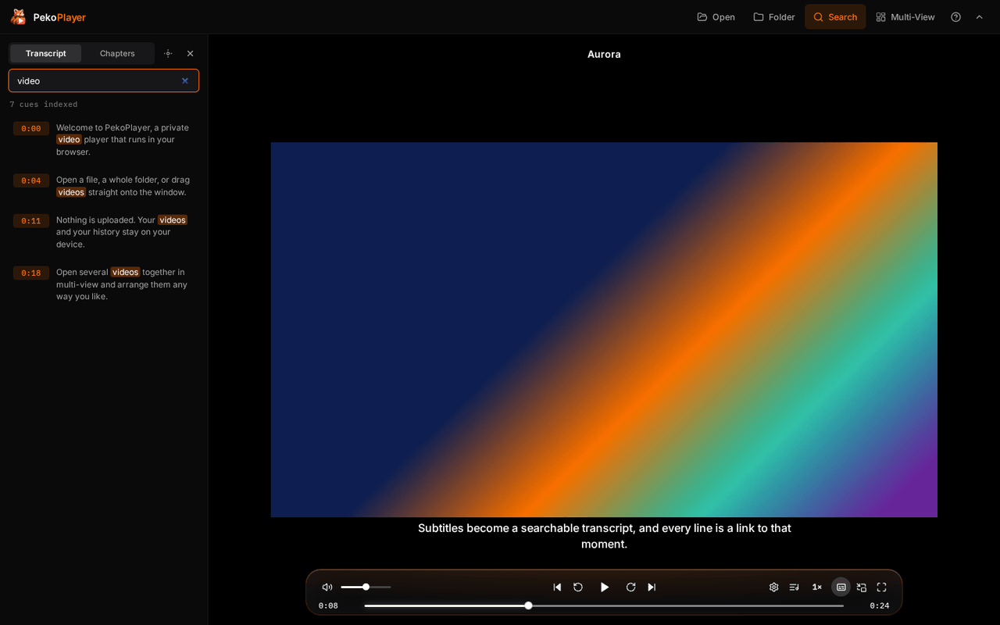<br><sub><b>Transcript search</b></sub></td>
    <td width="50%">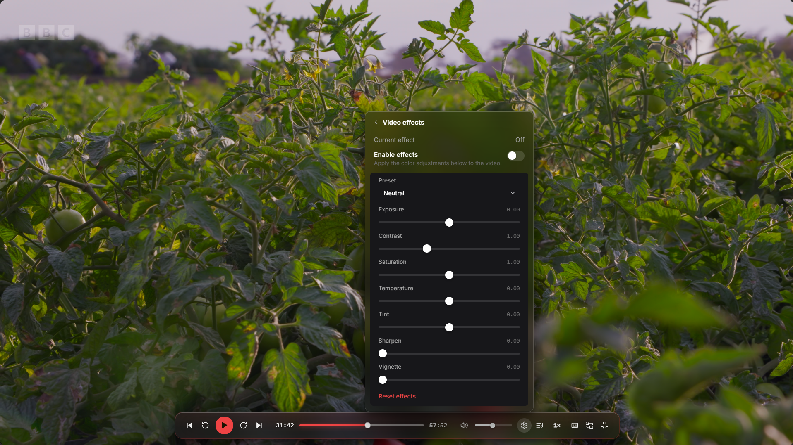<br><sub><b>Video effects</b></sub></td>
  </tr>
  <tr>
    <td width="50%">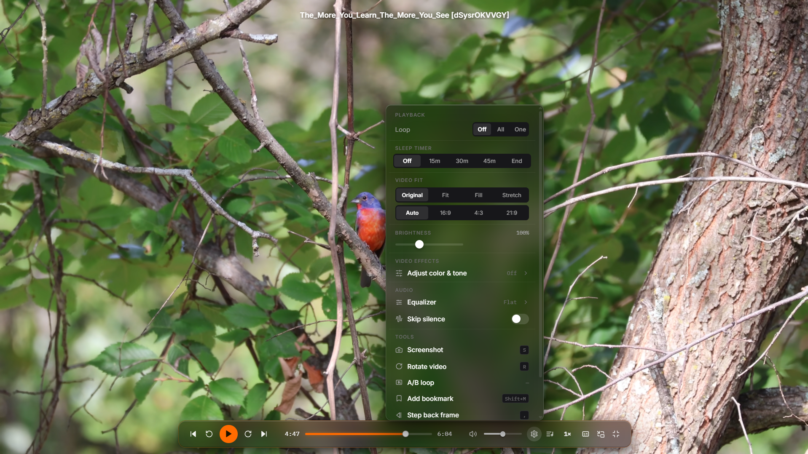<br><sub><b>Playback settings</b></sub></td>
    <td width="50%">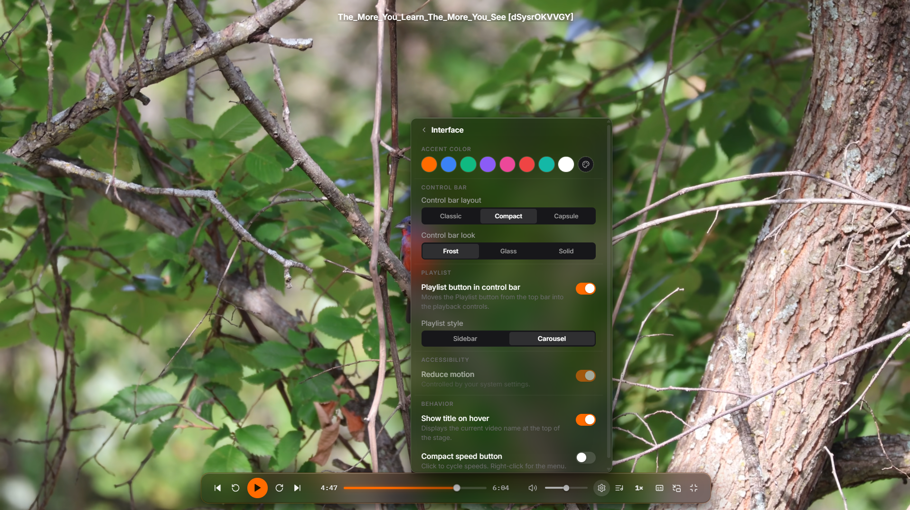<br><sub><b>Interface settings</b></sub></td>
  </tr>
  <tr>
    <td colspan="2" align="center">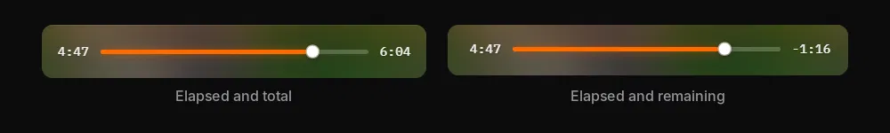<br><sub><b>Time display.</b> Click it to switch between elapsed and remaining time.</sub></td>
  </tr>
</table>

#### Control bar

Pick a layout and a look under **Settings → Interface**.

| Classic | Compact | Capsule |
|---|---|---|
| 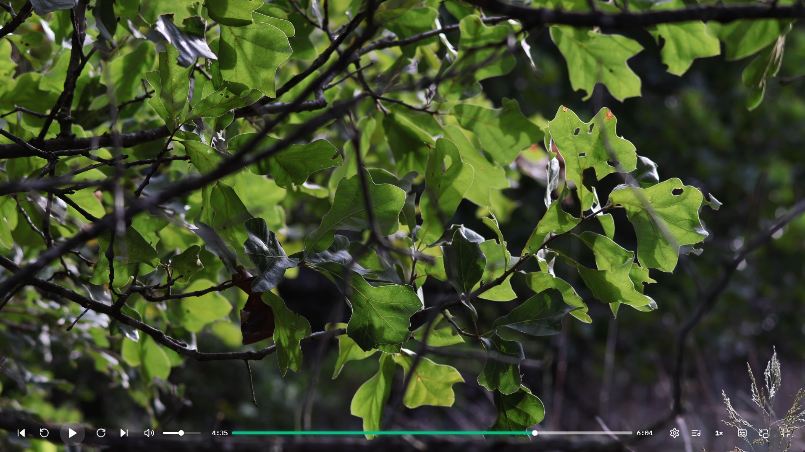 | 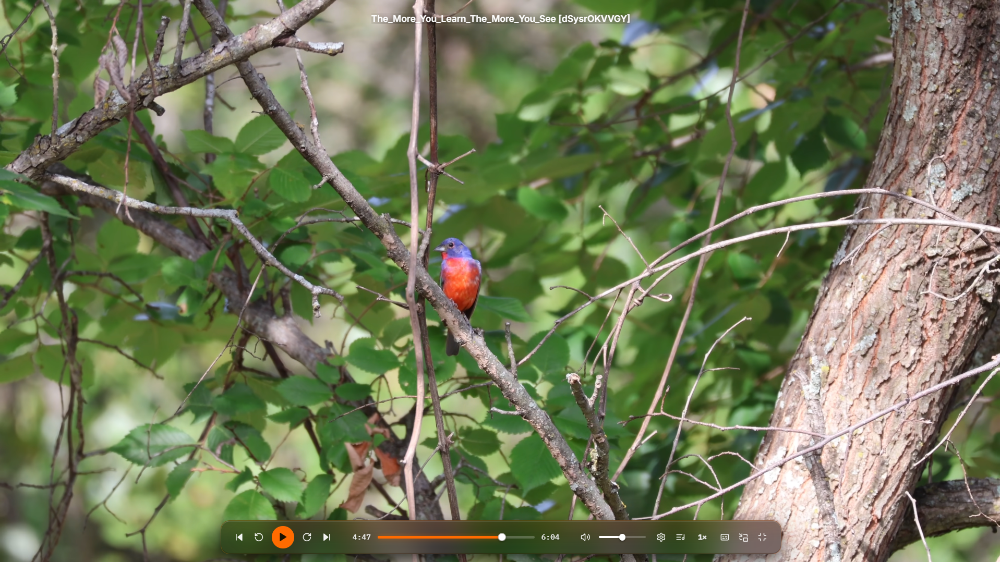 | 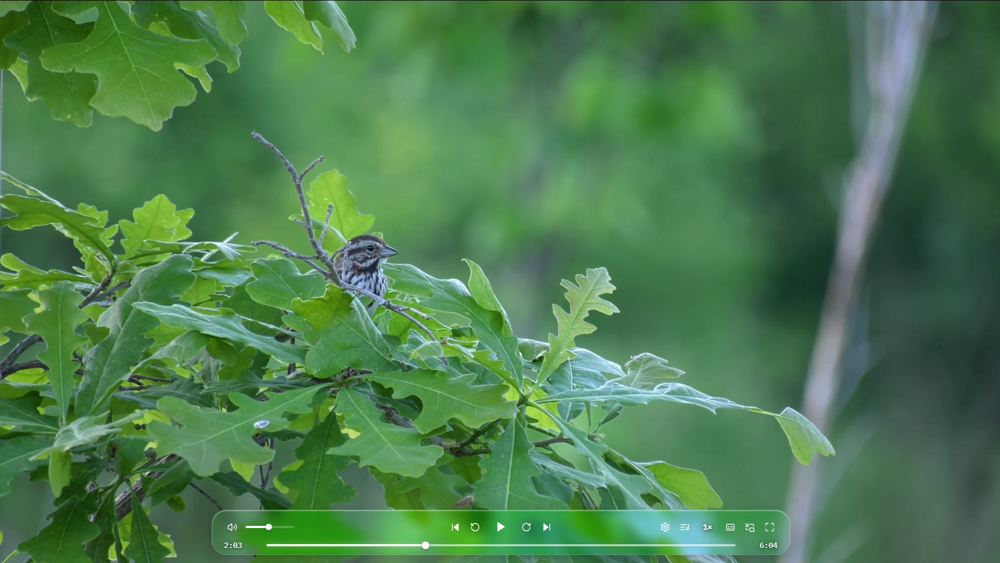 |

| Frost | Glass | Solid |
|---|---|---|
| 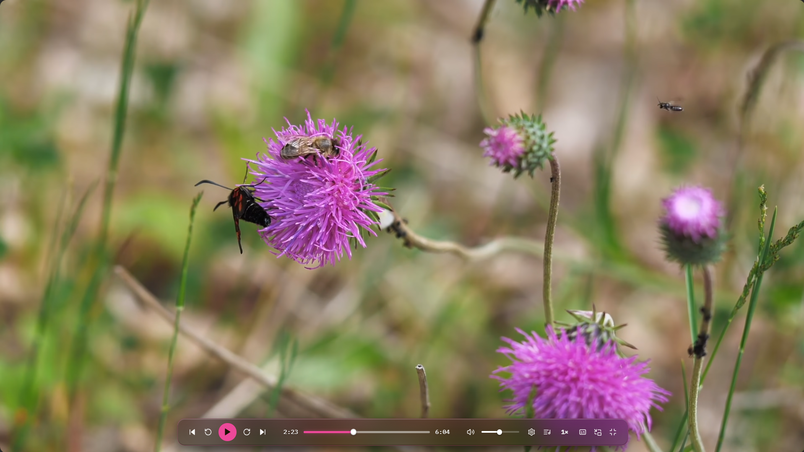 | 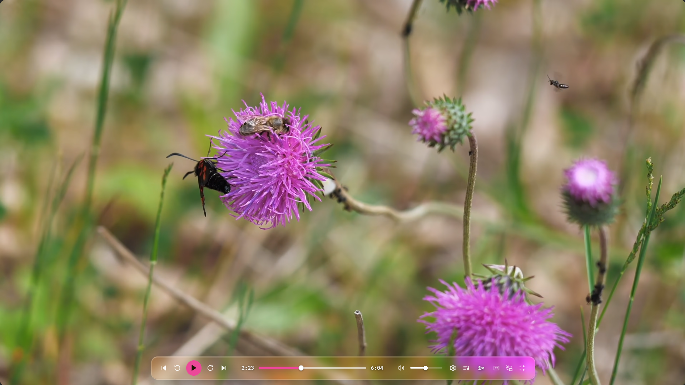 | 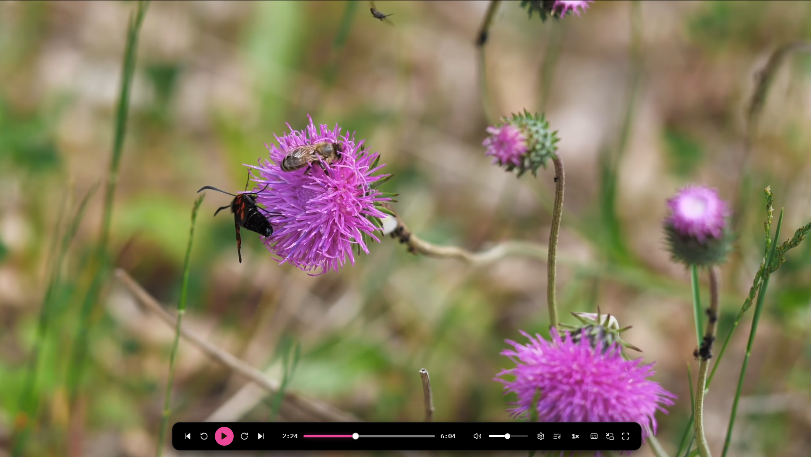 |

---

### Keyboard Shortcuts

<p align="center">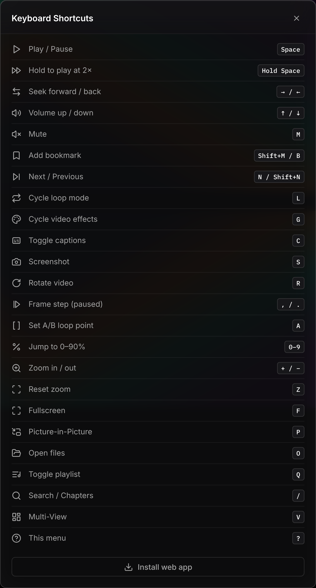</p>

| Key | Action |
|---|---|
| `Space` | Play / pause |
| Hold `Space` | Play at 2× |
| `←` `→` | Seek back / forward |
| `↑` `↓` | Volume up / down |
| `M` | Mute |
| `0`–`9` | Jump to 0–90% of the video |
| `,` `.` | Step one frame back / forward (paused) |
| `N` / `Shift+N` | Next / previous video |
| `L` | Cycle loop mode |
| `A` | Set A-B loop point |
| `B` or `Shift+M` | Add bookmark |
| `C` | Toggle captions |
| `/` | Search transcript and chapters |
| `G` | Cycle video effects |
| `R` | Rotate video |
| `+` `-` | Zoom in / out |
| `Z` | Reset zoom |
| `S` | Screenshot |
| `F` | Fullscreen |
| `P` | Picture-in-Picture |
| `O` | Open files |
| `Q` | Toggle playlist |
| `V` | Multi-view |
| `[` `]` | Move the active multi-view tile earlier / later |
| `Ctrl+Shift+D` | Debug panel |
| `?` | Show this list |

---

### Install

<table>
  <tr>
    <td><b>Web app</b></td>
    <td>Open the site and use your browser's install button, or <b>Install web app</b> in the shortcuts panel (<code>?</code>). After the first visit it works offline.</td>
  </tr>
  <tr>
    <td><b>Windows</b></td>
    <td>Download <code>PekoPlayer-&lt;version&gt;-portable.exe</code> from the <a href="https://github.com/OWNER/PekoPlayer/releases/latest">latest release</a> and run it. No installer, no administrator rights. The file is unsigned, so SmartScreen may warn: choose <b>More info → Run anyway</b>.</td>
  </tr>
  <tr>
    <td><b>Source</b></td>
    <td>See <a href="#run-from-source">Run from source</a>.</td>
  </tr>
</table>

The installed web app and the Windows app both appear in **Open with** for video files.

---

### Run from source

Requires [Node.js](https://nodejs.org) 22.

```bash
npm ci
npm run build
npm run serve          # http://localhost:8080
```

Use the served URL rather than opening `dist/index.html`; offline mode and the install prompt need `localhost` or HTTPS.

```bash
npm run desktop:start  # run the desktop app
npm run desktop:dist   # build release/PekoPlayer-<version>-portable.exe
```

---

### Browser support

Developed and tested in Chromium. Effects use WebGL2 in a worker (`OffscreenCanvas`); browsers without it hide the feature. Firefox and WebKit get a startup check in CI. Playable formats depend on your browser's codecs.

---

### Development

```bash
npm test               # lint, format check, static checks, unit tests, build, smoke tests
npm run test:unit      # fast tests for the pure logic
```

```
src/        App source: HTML, CSS, scripts, workers, icons
public/     Files copied to the build unchanged
desktop/    Electron shell for the Windows build
tools/      Build, check and dev-server scripts
tests/      Unit and smoke tests
docs/       Guides and screenshots
```

---

### Privacy

- No analytics, telemetry, cookies or accounts. `npm run check` fails the build if a telemetry API or an unapproved host appears in the source, and a smoke test confirms startup makes no third-party request.
- Fonts, icons and code are served from the same origin. Nothing loads from a CDN.
- Settings, resume positions, bookmarks and thumbnails stay in your browser's `localStorage` and IndexedDB. The Windows app keeps them in a `PekoPlayer-data` folder next to the executable.
- Two features contact third parties, only when you use them: YouTube tiles in multi-view (`youtube-nocookie.com`) and the subtitle search (opensubtitles.org).

---

### Documentation

[Architecture](docs/architecture.md) · [Multi-view](docs/multi-view.md) · [Desktop build](docs/desktop.md) · [Deployment](docs/deployment.md) · [Publishing](docs/publishing.md) · [Testing](docs/testing.md) · [Debug panel](docs/debugging.md)

[Contributing](CONTRIBUTING.md) · [Security](SECURITY.md) · [Disclaimer](DISCLAIMER.md)

---

### License

[MIT](LICENSE). Bundled Lucide icons are ISC ([license](src/icons/LICENSE)); bundled fonts use the SIL Open Font License ([license](public/fonts/LICENSE.txt)).

<p align="center"></p>
